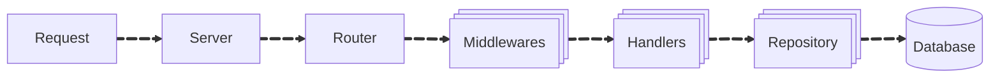

# 🧑‍💼 JobSite API

A RESTful backend service for a job portal built using Go (Golang) with Go-Kit and Gorilla Mux. This API supports user authentication, job listings, and admin job management.

<p align="center">
  
  

  
  
</p>


## 🎯 Features
- User Registration & Login
- JWT-based Authentication
- Forgot & Reset Password
- Job Listings (Public)
- Lookup APIs (Countries, Job Types)
- Admin Job Management (Create, Update, Delete)
- Middleware-based Role Authorization

## 🚀 Installation
1. Clone the repo: `git clone https://github.com/NishanthSaravanan/Senthil-Nov2025-RTE.git`
2. Install dependencies: `go mod tidy`
3. Run the app: `go run main.go`

## 📁 Project Structure

```
RTE_jobsite/
│
├── handler/        # HTTP request/response encoding & decoding
├── service/        # Business logic
├── middleware/     # JWT & role-based middleware
├── router/         # API route definitions
├── models/         # Data models (if applicable)
└── main.go         # Application entry point
```

### ➡️ Control Flow



1. **Request**: Server receives the incoming request.
2. **Server**: Server processes the request and forwards it to the router.
3. **Router**: Router directs the request to the appropriate middleware(s).
4. **Middlewares**: The middlewares handle various tasks such as logging, authentication, security headers, tracing etc.,
5. **Handlers**: The request is passed to the appropriate handler, which validates the request and forwards it to the repository layer.
6. **Repository**: The repository layer communicates with the database to perform CRUD operations.


## 🔐 Authentication
- Uses JWT for secure authentication
- Role-based access (admin protected routes)

## 📡 API Endpoints
### 🔓 Public Routes
| Method | Endpoint               | Description            |
| ------ | ---------------------- | ---------------------- |
| POST   | `/api/register`        | Register new user      |
| POST   | `/api/login`           | User login             |
| POST   | `/api/forgot-password` | Request password reset |
| POST   | `/api/reset-password`  | Reset password         |
| GET    | `/api/jobs`            | List all jobs          |
| GET    | `/api/countries`       | List countries         |
| GET    | `/api/job-types`       | List job types         |

### 🔒 Admin Routes (JWT Required)
```Base Path: /api/admin ```
| Method | Endpoint     | Description |
| ------ | ------------ | ----------- |
| POST   | `/jobs`      | Create job  |
| PUT    | `/jobs`      | Update job  |
| DELETE | `/jobs/{id}` | Delete job  |


## 🛠️ Tech Stack
- Golang
- Go-Kit (Transport Layer)
- Gorilla Mux (Router)
- JWT Authentication
- Clean Architecture (Handler → Service → Repository)


## Contributing
Feel free to fork the repo and submit pull requests.

## Author
Senthilkanagaraj

GitHub: https://github.com/Senthilkanagaraj